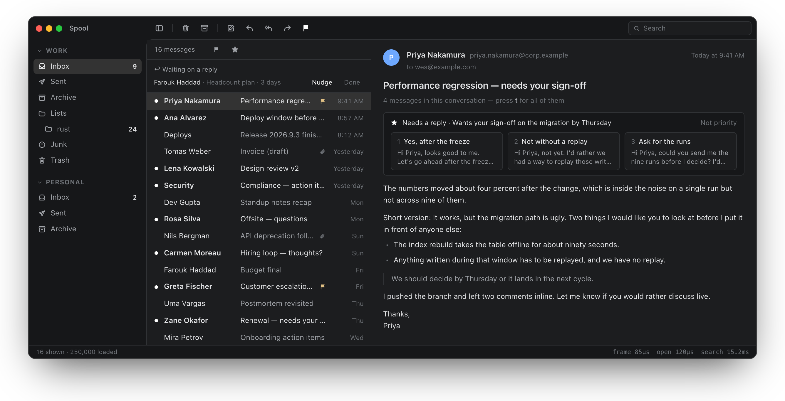
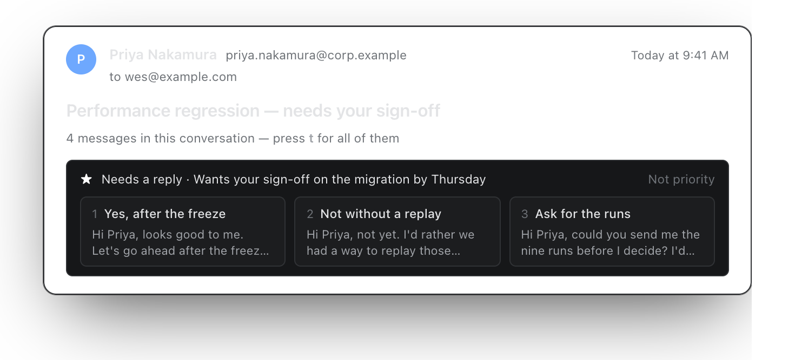

# Spool

An email client for macOS built on [gpui](https://crates.io/crates/gpui) — the
GPU-accelerated UI framework Zed is written in. Rust end to end, no Electron:
the interface is drawn on the GPU, and the only web view is the one that shows
HTML mail [as its sender laid it out](#rendering-html-mail).

The question was: what would email feel like if Zed were an email client?
This is a working answer to that, at a scale where the answer means something.

<picture>
  <source media="(prefers-color-scheme: light)" srcset="docs/screenshot-light.png">
  
</picture>

**[Download Spool](https://github.com/wes/spool/releases/latest/download/Spool.dmg)**
— macOS 13 or later, Apple silicon and Intel. Signed, notarized, and it
updates itself.

You don't have to connect an account to try it: the first window offers a
**demo mailbox** of 50,000 made-up messages, kept apart from your own mail.
Nothing in it syncs or sends, and one click at the foot of the sidebar takes
you back out and deletes it. [Built from source](#building), you can make a
bigger one:

```
spool --demo 250000
```

## Where it stands

**Working:** three-pane keyboard-driven UI, multiple accounts with a unified
view, virtualized message list, full-text search, conversation threading,
HTML mail, flags/archive/move/delete written back to the server through a queue
that survives being offline, command palette, settings pane with four themes,
IMAP sync against real servers, [composing](#composing) — replies, forwards,
attachments, signatures and drafts, as text or HTML — Gmail sign-in with
Google or an app password for any IMAP server, `mailto:` links, optional AI
through ChatGPT or Claude (writing tools, a priority sort with quick replies,
and reminders when nobody replies), [Clients](#clients) — a client book and
sales board built from your mail — and [extensions](#extensions) — WebAssembly components
that contribute commands, badges, banners and panels, and that run rules over
mail as it lands.

**Not built:** the agent layer — see
[Where agents plug in](#where-agents-plug-in) — and changes made on another
device arriving here (see [Caveats](#caveats)).

## Measured

On an M-series MacBook, from `spool --bench 250000` and the app's own
status bar:

| | 100,000 messages | 250,000 messages |
|---|---|---|
| Frame build time (mean / worst) | 76µs / 117µs | **85µs / 223µs** |
| Open a message | 95µs | 120µs |
| Full-text search | 5.4ms | 15.2ms |
| Load the whole mailbox list | 100ms | 290ms |
| Ingest | 31,500 msg/s | 29,000 msg/s |
| On disk | 111 MB | 274 MB |

The numbers that matter for feel are the first two. A 120Hz frame budget is
8,333µs; building a frame with a quarter-million messages loaded takes about
**1% of it**. Frame time scales with the size of the *window* — a taller one
shows more rows — not with the size of the mailbox, which is the whole point.
Scrolling, selecting and typing in the search box do not get slower as mail
accumulates, because the work per frame does not depend on how much there is.

Search *does* grow with corpus size — it is doing real work over more data —
but 15ms across a quarter-million messages still lands inside a single frame
at 60Hz, so results update as you type.

The app can show these numbers in its own status bar while you use it —
`cmd-alt-b`, or **View → Toggle Status Bar**, remembered between launches. It is off by default,
because a readout nobody asked for is a strip of numbers along the bottom of
every window forever; a client that claims to be fast should be willing to be
measured, not insistent about it.

The **sync progress bar lives there too** — a three-segment bar of what is
queued, what four connections are fetching right now, and what just finished.
It used to sit at the foot of the sidebar, which is always on screen, so every
arrival of mail put a band of chrome under the folder list whether or not
anybody wanted to watch it. In the status bar it costs nothing when the bar is
off, and is there when it is on. What the sidebar still says about a sync is
the pulsing dot on the folder being fetched, which takes exactly the space the
folder's count did.

### Keeping them

```
cargo perf                   # measure this commit and record it
cargo perf --report --open   # the whole history, as charts
```

Builds a deterministic 100,000-message corpus, measures about thirty things,
compares them against the last run on this machine, and appends a record to
`bench/history/<machine>.jsonl` — committed, so the question "did this change
make it slower?" is answered against history rather than memory. A run takes
about a minute, and `--report` turns the accumulated history into a page of
sparklines — one per benchmark, hover a point for the commit that produced it.
See [crates/bench](crates/bench/README.md).

It reports a median rather than a mean, a pessimistic tail beside it, and a
delta only where the delta means something: a row that moved past the threshold
but no further than its own noise is marked `(noise)` rather than reported as a
regression, because a tool that cries wolf is one nobody reads.

Separately, [bench/](bench/README.md) measures Spool *against other clients*
from the outside — synthetic clicks and screen capture, in milliseconds. Both
are honest; they do not belong in the same table.

## How the speed is actually achieved

Three decisions do nearly all of the work. None of them is exotic; the
discipline is in not breaking them.

**1. The list is virtualized.** gpui's `uniform_list` knows the row height, so
it builds elements only for the ~20 rows on screen. Forty messages and four
hundred thousand cost the same per frame. The rule this imposes on
`message_list.rs` is that a row may not do anything expensive — no scans, no
allocation of the full list, no database access. Everything a row draws is
already in the `Envelope` struct.

**2. `render` never touches the database.** Every query runs on a background
thread and writes its result back into the workspace. A slow query can delay a
sync; it cannot drop a frame. Each reload carries a generation number, so a
slow query that finishes after a newer one discards its own result instead of
overwriting fresher data.

**3. Work happens once, at the right time.** Snippets are computed at ingest,
not at paint. Message bodies are parsed into blocks when opened, not per
frame. Flag changes update the in-memory envelope first so the row repaints
immediately, and persist in the background.

The store is SQLite with an FTS5 index over subject, sender and body. The
index is *contentless* — it stores postings, not a second copy of every
message — which keeps a six-figure mailbox's index small enough to stay in the
page cache.

## The message list

Two shapes, switched in Settings → Appearance or with `cmd-alt-d`.

**Slim** is the default: one line per message, laid out in columns — unread
indicator, sender, subject, attachment, date. Each column can be turned off
except the last one, because a row with no columns is a row with nothing in it
and is not a state worth being able to click your way into. The pane widens in
slim, since five columns have to share one line where the detail layout gives
each field a line of its own.

**Detail** is the older shape: sender and date, subject, and a preview of the
body — one line, two lines, or none.

**Selecting and filing.** `cmd`-click adds a row to the selection, shift-click
and `shift-↑`/`shift-↓` extend a range, `cmd-a` takes the lot, and every filing
action — archive, trash, read, flag — works on the set. Dragging any of it onto
a folder in the sidebar moves it there; mail cannot cross accounts, because
IMAP has no move between servers and a copy uploaded under a different identity
is not what dragging a row looks like it does. `cmd-z` puts the last move back.

Row height is arithmetic on the density and the preview rather than a stored
number, because `uniform_list` needs a fixed height to decide which rows are on
screen, and a second copy of that number is a second thing to keep in step. The
column widths are computed the same way: gpui only ellipsizes text when the
width is definite at measurement time, so a subject that got its width from
`flex_1` would be clipped by the pane instead of ending in an ellipsis.

### Composing

**A composer is a window of its own.** Writing a message is not a mode the
mailbox enters — it is a second thing you are doing, usually while looking at
the first. A panel over the list means you cannot read the message you are
answering, cannot start a second reply, and cannot put the draft on another
display, and people do all three constantly.

So each draft gets a real window with the system's own title bar, titled with
its subject as you type it, cascaded so a second one is visibly a second one.
Answering the same message twice brings the window that is already open forward
rather than opening a rival draft. Escape and `cmd-w` save and close; `cmd-q`
saves every open composer on the way out.

The body is set in **monospace**, because this *is* plain text: what is typed
is what arrives, and a proportional face hides the alignment, the quote markers
and the wrapping the recipient will actually see. Plain-text mail is rendered
the same way in the reader, for the same reason — a message laid out by hand
with dashes and spaces has no other layout to lose.

**The body is a white page**, in every theme — the one place the app does not
follow its own palette. A message is composed on the page the *recipient* will
read it on, and that page is white in essentially every mail client there is;
writing pale text on a dark ground and posting it into a white one is how
people send unreadable mail without knowing it. The headers and the footer stay
in the app's own chrome, which is the arrangement Mail uses.

**`cmd-n` is always a blank message.** A draft closed mid-session is handed back
to the mailbox, as is one left over from a previous session and one whose send
failed — announced in the status bar rather than thrown on screen at launch —
and `cmd-shift-d` is what picks it back up. That separation matters: New Message
used to hand back whatever was waiting, which meant it could open holding a
half-written reply to a message selected an hour ago, recipients and quote
included. The one command that has to be predictable is the one called New.

Until there is a drafts list to open them from, that hand-back is what keeps a
closed draft reachable at all.

**Attachments** go on with **Attach…** in the footer, by dropping files
anywhere on the composer window, or by pasting an image straight from the
clipboard — a screenshot arrives as `Pasted 1.png` rather than as a part the
recipient cannot name. A forward carries the original's files with it, fetching
any the sync was too large to keep from the server first; inline images are left
out, since they belong to the quoted body and are already in it.

The **bytes are read at the moment a file is attached**, not the path
remembered. A draft outlives the state of the filesystem around it: saved on
Monday and sent on Friday, by which time the file may have moved, been deleted,
or been edited into something the sender never meant to send. It is also the
only representation that suits both sources, so a file picked from disk and a
part carried along from a forward stop being distinguishable the moment they
are attached.

The strip under the body gives the **encoded** total, which is about a third
larger than the size on disk — base64 is four characters for every three bytes,
and quoting the smaller number would tell you a 24MB message is fine when it is
32MB on the wire. Past 25MB it says so and nothing else: Spool does not know
what the server at the other end accepts, and refusing to send something it
would have taken is worse than letting you find out.

A message with no attachments is rendered exactly as it always was —
`text/plain`, not a multipart envelope wrapped around one part for no reason.

### Signatures

One per account, edited in Settings → Accounts and stored in `accounts.toml`
next to the server details — two accounts are two different people, which is
the whole point of having two. It goes in under a `-- ` line (the trailing
space is load-bearing; without it, other clients see a row of hyphens rather
than a signature) and **above** the quoted text on a reply, because a reply is
read from the top and a signature under the entire history of a thread is one
nobody ever sees.

A composer that opens with a signature, recipients and a quote in it has still
not been written in, so autosave compares the draft against what the composer
opened with rather than against empty.

### Folders

New Folder, from right-clicking an account in the sidebar or File → New Folder
(`cmd-shift-m`), creates a folder on the server; File → Rename
Folder and Delete Folder act on the one you are standing in. Nesting is the
account's own delimiter, typed — `/` on Gmail, `.` on a stock Dovecot — read
off the paths sync already brought back rather than assumed.

Each one runs on the server first and only then touches the local store: a
client that writes locally and hopes the server agrees is a client that shows
folders which do not exist. Renaming carries the folders nested inside it, the
way the server's own `RENAME` does. Deleting destroys server-side mail, so it
names the folder, says how many messages go with it, and refuses outright for
the special-use folders (Inbox, Sent, Drafts, Trash, Junk, Archive) that sync
files mail into by role.

### Search

Words match subject, sender and body, quoted and prefix-wildcarded so results
narrow as you type. Operators narrow further:

| | | | |
|---|---|---|---|
| `from:ana` | sender name or address | `is:unread` | also `is:read` |
| `to:bo` | recipient, including Cc | `is:flagged` | also `is:unflagged` |
| `subject:"the roof"` | words in the subject | `has:attachment` | carries a file |
| `in:archive` | folder name | `after:2026-01-31` | also `after:7d`, `today` |
| | | `before:2026-01-31` | |

The rule the parser is built around is that **nothing typed into the box is an
error**. An unbalanced quote, a stray colon, a date that is not a date — all of
it comes back as a search that runs. An operator it does not recognise is not
rejected; it falls through and becomes ordinary search text, so `10:30` and a
pasted URL search for what you typed. A mail client that refuses to search
while you are still typing is one you stop typing into.

### The window chrome

The sidebar runs the full height of the window and the header bar sits only
over the content beside it — the traffic lights live in the sidebar's own top
strip, and no horizontal rule crosses it. That continuous panel down the side
of the window is most of what makes it read as a Mac app rather than a web page
in a frame. Hide the sidebar and the header takes the inset
back, because then it is the thing against the left edge.

The header bar holds a toolbar — sidebar, trash, archive, new message, reply,
reply all, forward, flag — and the search field, and nothing else. There is no
title in it: which mailbox you are in is what the sidebar's own selection says,
and repeating it in the chrome is a second place to keep in step. Every button
dispatches the same action its keystroke and its menu item do, and every one
carries a tooltip, because a row of glyphs nobody can name is a row of glyphs
nobody presses. The flag also *reports*: it takes the accent colour when the
selected message is flagged.

The header bar carries the **same panel as the sidebar it continues from**, and
no rule runs under it. The list and the reader sit below as a card on top of
that chrome — their own background, a hairline border, and a rounded top-left
corner where the header and the sidebar meet. One corner does most of the work
of saying which of the two surfaces you are looking at, which is the trick
Linear uses and the reason its window reads as one piece rather than three
panes bolted together.

## Themes

`cmd-,` opens Settings. Two themes: **Light** and **Dark**, both neutral and
low-chroma, so the only saturated things on screen are the ones carrying
meaning.

Each card in the picker paints a miniature of the three-pane layout in the
palette it is offering, so you choose by looking rather than by reading four
names. Hovering a card previews it across the whole window; clicking commits
and writes `~/.config/spool/settings.toml`.

The active theme is a gpui `Global` that the whole window reads through
`cx.theme()`. No call site constructs a palette and no call site writes a color
literal, which is why adding a theme is one function returning a struct.

## The window

Spool opens where you left it. Position, size and whether it was maximized
are written to `settings.toml` when you quit, and restored next launch.

Remembered geometry has to earn its restoration: if it is absurdly small, or
sits on a display that is no longer attached, it is discarded in favour of a
centred default. Restoring a window onto coordinates that no longer exist
leaves you with an app you can hear but cannot see.

Geometry is read once at quit rather than tracked per frame — polling the
platform for a window rectangle at 120Hz to catch a value that changes when
you drag would be wasteful. The cost is that a force-kill loses the last move.

## Priority

Off until it is turned on: **Settings → AI → Sort new mail by priority**. The
AI chosen there — ChatGPT or Claude — reads new inbox mail as it syncs and
decides whether it needs you, and what for. Mail somebody is waiting on an
answer to, and mail that wants something done or known soon, gets a line above
the message saying why in a dozen words. Newsletters, receipts and
notifications stay where they were.

<picture>
  <source media="(prefers-color-scheme: light)" srcset="docs/priority-light.png">
  
</picture>

Mail that wants an answer comes with three replies already written: a yes, a
no or not yet, and one asking for what you would need to decide. Click one, or
press `1`, `2` or `3`, and it opens in an ordinary composer, addressed and
quoted, to change and send. The model writes; Send is still a key you press.
Where a reply would need a time or a price it was never told, it leaves a
placeholder like `[time]` rather than inventing one.

`p`, or the ★ above the list, narrows any mailbox to what needs you; `shift-p`
puts a message in or takes it out, and the sort is told about that decision
from then on. **Follow-up reminders** are a switch of their own in the same
pane: sent mail that expected an answer and got none comes back above the list
— after three days, unless the chip beside Send said otherwise — with a nudge
written.

What leaves the machine is said exactly: each new inbox message's sender,
whether you were on To or Cc, its subject and its first 1,500 characters,
twelve to a request. Mail from a mailing list, and your own, is sorted by rule
and never sent. The first run reaches back three days, not through the archive.

## Clients

Built in, and off until it is added: **Settings → Extensions → Clients → Add**.
Until then none of it exists — no menu item, no shortcut, no mark in the reader,
and no index kept as mail arrives — so a mail client is all anybody who never
wanted a CRM gets. Removing it puts it away again and keeps the book.

Once added, `cmd-shift-c` opens a second window: everyone you correspond with,
across every account, with the whole history of each — and, for the ones you
sell to, notes, tags and a place on a board. It opens on whoever the message
you were reading is about, and every message header carries a mark that does
the same: the person, scrolled to and chosen, with a client's stage beside it.
The person button at the end of the toolbar opens it as it was left.

A window rather than a tab, for the reason Settings is one: what you know
about a client is something you check *because of* a message, and a pane over
the mailbox is a pane you cannot check it against.

**Nothing has to be typed in first.** The store keeps a people index — one
row per person per message, written in the same transaction as the message —
so a profile's history is a seek, not a search, and the directory is there the
first time it opens. An existing mailbox fills its index once, in the
background, newest first; 250,000 messages took about three seconds in batches
that never held the store for more than 45ms. The index costs ingest about 6%,
and only while Clients is added; mail that arrives while it is not is caught up
on by the same backfill the next time it is.

**Most people in your mail are not people.** The directory starts with the
ones you have written to, which leaves out newsletters, receipts and
`noreply@` without a rule for any of them. Mail you send only to yourself — a
sign-up or contact form on your own site — is from whoever it is about: the
`Reply-To` address, or the address written in it. Somebody becomes a *client* the
moment you give them a stage, a tag or a note; until then they are only in
your mail. A client can be several addresses, or a whole domain — everyone at
a company.

**The board** is the sale as columns, and a client is on it only once they
have a stage. Cards say what the mail says: *needs reply* when their message
came last, *quiet* when an open sale has gone a fortnight with nothing either
way. Drag a card, or press `[` and `]`; `cmd-z` puts it back. Edit stages…
adds, renames, reorders and deletes columns. Every book shares one set of
stages until it is given its own — a sign-up list and a design studio do not
sell the same way — and on all books each set is a board of its own, one under
the other. Pick several people in the directory (`cmd`-click, `shift`-click or
`shift`-arrows) to move them all at once. A book you do not keep clients in can
be hidden; its people leave the lists, and anyone already a client stays.

**People who have never written** come in by import — CSV (Google and Outlook
exports included), vCard, or JSON — each into an account's book, with the
columns guessed and shown for correcting before anything is written.
**Sources** do the same on a schedule: any https address that answers with a
list of people. Point one at an admin route that lists your signups and they
arrive on their own; put `{since}` in the address and only the new ones are
asked for. Tokens go in the keychain.

**Writing to a group.** Email… over the directory writes to whoever the list
is showing — a tag, a book, a search, the people picked — and the envelope on a
board column to everyone in that stage. It opens the composer: the same window
as any message, text or HTML, signed, from the book being looked at, with the
To line naming the group and everyone in it listed down the right, a box to
leave each out and their own copy shown on choosing them. Each person gets a
message of their own, addressed to them alone, with `{first_name}`, `{name}`,
`{company}` and `{email}` filled in; `{first_name|there}` says what to write
for somebody whose mail never gave a name. Send asks to be pressed twice. They
go one at a time on one login, a little apart, and stop at the first sign the
server wants them to slow down. The copies are filed in Sent, which is also
what puts each one in that client's history.

Notes, tags and the board live in `clients.db`, beside the mail store and
deliberately not in it. The mail store is a cache of your servers; this is the
only copy of what you wrote, so resyncing or rebuilding mail can never take it
with it. Nothing in it refers to the mail store's row ids — people are named by
address and companies by domain.

## Keys

Modal-ish and vim-flavored, in the sense that your hands stay put.

| | | | |
|---|---|---|---|
| `j` `k` `↑` `↓` | move | `cmd-k` | command palette |
| `g g` / `shift-g` | newest / oldest | `cmd-f` `/` | search |
| `enter` | open | `tab` | all / unread / flagged |
| `u` | toggle read | `t` | whole conversation |
| `f` | toggle flag | `cmd-b` | toggle sidebar |
| `e` | archive | `ctrl-n` `ctrl-p` | next / prev mailbox |
| `backspace` | move to trash | `cmd-r` | sync |
| `shift-c` | copy sender | `cmd-,` | settings |
| `cmd-a` | select all | `shift-↑` `shift-↓` | extend selection |
| `cmd-z` | undo the last move | `p` | priority mail only |
| `shift-p` | mark priority, or not | `cmd-alt-p` | formatted / plain body |
| `1` `2` `3` | quick reply | `cmd-alt-d` | slim / detail list |
| | | `escape` | back out one layer |

In the sidebar — click in it, or press `←` from the list — the keys work the
way Finder's list view does:

| | |
|---|---|
| `↑` `↓` `j` `k` | move between accounts and folders, opening each |
| `→` | unfold, or step into an open folder; on a folder with nothing under it, go to its messages |
| `←` | fold, or step out to the folder or account above |
| `enter` `escape` | back to the message list |

Every one of these is a gpui `Action`. That is why the command palette is a
list and not a second implementation of the menu: keystrokes, palette entries
and click handlers all dispatch the same action. Adding a command to
`actions::commands()` makes it reachable three ways with no further wiring.

## Connecting a real account

Press `cmd-,` and go to **Accounts**. There are two kinds:

**Gmail** is one button. Pick *Gmail*, name the account, press **Sign in with
Google** — your browser opens, you approve, and that is the setup. Spool
never sees your Google password, and access is revocable from your Google
account's security settings at any time.

**Everything else** is a standard IMAP/SMTP server: host, port, SSL/TLS or
STARTTLS, and a password. **Test connection** authenticates against IMAP *and*
SMTP before you commit, so a wrong port or a rejected password shows up here
rather than three days later. Most providers reject your normal login password
over IMAP and want an app-specific password instead.

Nothing the app writes puts a secret in a config file. Passwords and OAuth
refresh tokens go to the macOS keychain (`security add-generic-password`),
under the service `spool`; `accounts.toml` keeps only servers and a note that
a credential exists. On platforms without a keychain Spool knows how to use,
they fall back to a `0600` file in the data directory, which is worse and says
so in the pane.

### The Google OAuth client

Google sign-in needs an OAuth client, and it belongs to *the app*, not to the
user — that is what makes setup one button instead of a trip to a cloud
console. A build with no client says so in the pane, and the sign-in button
does nothing.

To give a build one: in the [Google Cloud console](https://console.cloud.google.com/apis/credentials),
enable the Gmail API and create an OAuth client of type **Desktop app**, then
set `SPOOL_GOOGLE_CLIENT_ID` and `SPOOL_GOOGLE_CLIENT_SECRET` — read at run
time if set, and otherwise baked in at compile time. Pasting them into
`BUILT_IN_CLIENT_ID` and `BUILT_IN_CLIENT_SECRET` in `crates/net/src/oauth.rs`
works too. The source ships with both empty: official builds have their
client injected by the release pipeline (see [RELEASING.md](RELEASING.md)),
so a checkout of this repository builds without Google sign-in until you give
it a client of your own.

A desktop client's secret is not a secret in the usual sense; it ships inside
every copy of the app, so it cannot be kept, and OAuth calls such a client
*public* for exactly that reason. What protects the exchange is PKCE plus the
loopback redirect, both of which this flow uses: Spool opens a listener on an
OS-assigned port, sends the browser to Google with an S256 challenge, and
checks the `state` on the way back. The scope requested is
`https://mail.google.com/`, the only one that reaches IMAP and SMTP. The
refresh token goes to the keychain; the hour-long access token is kept in
memory and never written down.

### The file

Still editable by hand, and `spool --write-config` writes a commented
example. The pane rewrites it when you change an account, which drops comments
— the header says so.

```toml
[[accounts]]
name = "Work"
email = "me@example.com"
auth = "password"                 # or "google-oauth"
imap_host = "imap.example.com"
imap_port = 993
imap_security = "tls"             # tls | starttls | plaintext
smtp_host = "smtp.example.com"
smtp_port = 465
smtp_security = "tls"
initial_limit = 2000

# With nothing else set, the password comes from the keychain. An explicit
# source wins, for anyone who keeps credentials somewhere else:
# password_command = "security find-generic-password -s spool -a me@example.com -w"
```

Presets for iCloud, Outlook, Fastmail and Yahoo are written but commented out
in `crates/net/src/config.rs`; those accounts work today through *Other*, and
turning a preset back on is uncommenting it.

Sync is local-first: the first pass pulls the newest `initial_limit` messages
per folder (not a decade of archive before you can read today's mail), and
later passes ask only for UIDs above the highest one stored — one round trip,
usually zero messages. `BODY.PEEK[]` throughout, so syncing never marks mail
read as a side effect.

## Layout

```
crates/core     types, threading, HTML→blocks   — no DB, no UI, no I/O
crates/store    SQLite + FTS5, demo corpus      — the source of truth
crates/net      IMAP, config, MIME parsing      — everything that can hang
crates/ext      the extension host              — wasmtime, no UI
crates/app      the gpui application
extensions/     the SDK, and extensions written with it — built for wasm
```

The split is not ceremony. `core` has no dependency on a database or a UI
framework, so threading and content parsing are testable as pure functions —
which is most of the 94 tests. `net` is quarantined because DNS, TLS and a
server that stops responding mid-FETCH are the things that hang a mail client.

Threading is a cut-down JWZ: messages link by `Message-ID` / `In-Reply-To` /
`References`, with union-find so a parent arriving *after* its children (which
is the normal case over IMAP, since mail arrives newest-first) merges the
conversations rather than splitting them. Subject matching is a fallback used
only when a message carries no reply headers at all — applying it more eagerly
is how clients end up merging every message titled "hello" into one thread.

## Rendering HTML mail

**On macOS the reader is a `WKWebView`.** A newsletter is a document its sender
laid out in CSS, and no reduction of it to headings and paragraphs is going to
look like the thing they sent. The header, the image bar and the attachment
chips stay gpui elements; the body is WebKit, positioned over the reader pane.

Three things make that defensible rather than reckless:

- **The document is sanitized before it is ever loaded** (`core/src/sanitize.rs`).
  Scripts, frames, objects, event handlers and `javascript:` URLs are removed
  from the source text — along with their subtrees, so nothing survives as
  markup to be parsed again — and until the reader presses **Load images**,
  every remote URL goes too, including the ones hiding in `url(...)` inside a
  `style` attribute. Parts that arrived *with* the message are inlined as
  `data:` URLs, because those cost nothing and tell the sender nothing.
- **Scripting is off** in the view's configuration, so the sanitizer is the
  second line rather than the only one.
- **The view never navigates.** A delegate refuses every navigation but the
  initial load; a clicked link goes to the system browser, which is where a
  stranger's URL belongs.

`cmd-alt-p` switches to the plain-text body, which is rendered by the block
renderer below — as is any message with no HTML, any conversation of more than
one message, and everything on every other platform. The block renderer is also
what search, snippets and threading read, so it is not a fallback that rots.

The mechanics are the awkward part, and worth knowing about: gpui draws into a
Metal layer, so a native subview cannot be composited *into* the scene. It sits
on top of it. That means the web view has to be moved to match the layout on
every frame (a custom `Element` exists purely to learn its own bounds and place
it), and it has to be hidden whenever anything opens over the reader — settings,
the composer, the palette — because otherwise the message would draw over the
modal.

### The block renderer

There is no embedded browser here either. HTML is parsed into a flat list of
blocks —
headings, paragraphs, quotes, lists, code, rules, images, tables — and laid out
with the same text system as the rest of the window. A paragraph becomes one
`StyledText` with highlight runs rather than a row of inline divs, which is
what makes wrapping work and long messages cheap to scroll.

The HTML part is what you see. Mail carries both bodies and the plain one is a
lossy transcription of the other, usually automated, with the links torn out.
`cmd-alt-p` switches to it for the senders whose HTML is a mess, and the reader
says which one it is showing when there was a choice.

**What the sender hid stays hidden.** Marketing mail opens with a preheader —
the teaser the inbox list shows — in a `display:none` container, followed by
hundreds of `&shy;` and `&zwnj;` entities padding the preview out so the client
does not show the body instead. Both are handled: elements marked
`display:none`, `visibility:hidden`, `mso-hide:all` or `hidden` are skipped
with their subtrees, and the invisible padding characters are decoded and then
dropped, so a newsletter does not open by saying the same sentence twice.

The hidden check is deliberately narrow. `font-size:0`, `max-height:0` and
`opacity:0` also appear on ordinary wrapper elements where they control
whitespace rather than visibility; treating those as hidden blanks the whole
message, which is exactly what a broader first attempt did to a real
newsletter.

A joiner is dropped only where it is padding, never between two visible
characters — `👨‍👩‍👧` stays one emoji and Persian and Indic words keep the
ZWNJ inside them.

The hidden check reads *attributes*, not the text of the tag. `hidden` is a
word that turns up in CSS — `overflow: hidden` is on the rounded-corner card in
most transactional mail — and finding it inside a `style` value once hid entire
messages.

**Tables are the reason mail looks the way it does.** Almost every newsletter
and receipt is built out of nested layout tables, so rendering all of them as
grids turns mail into a spreadsheet, and rendering none of them loses every
receipt. The parser decides per table: an explicit `<th>` is the sender saying
"this is a table" and settles it; without one, it takes at least two consistent
rows two columns wide with a single block per cell. Anything else is
scaffolding, unwrapped so its contents flow normally. A one-cell wrapper
disappears; the receipt nested three levels inside it does not.

Rows whose cells are all empty are dropped before any of that — mail draws bar
charts as table cells with a height and a background and no content, and
rendering those as blank grid lines claims the sender mailed an empty row. And
a layout row of short cells reads as one line, because those cells sat side by
side: stacking them turns a band of stats into a column and a chart's day axis
into seven paragraphs each saying one letter.

**The sender's colours are kept, and adapted.** A green `RESOLVED` badge, a red
error count, monospace on a service name — those carry meaning, and dropping
them leaves a message that is structurally right and says nothing. But mail is
designed against the sender's own background: `#5c554c` is a legible muted grey
on near-black and invisible on white. So the parser keeps colours raw and the
reader adapts them, moving only lightness until the colour clears the WCAG AA
ratio against the surface it landed on, and falling back to the theme's own
text when a colour cannot get there.

A colour the sender put on a fill of their own is judged against that fill and
against a much lower bar, because the pair was chosen together: white on a
green badge is what every status page looks like and it does not clear AA.
Translucent fills — `rgba(74,168,101,0.15)` is how mail tints a badge — are
blended over this window's background rather than painted opaque, so a tint
stays a tint. What is still dropped is presentation that carries no meaning:
page backgrounds, fixed widths, and fonts nobody has.

**Images arrive two ways, and the difference is the whole design.** An image
attached to the message is already on disk, so it is decoded when the message
opens and drawn like any other content — `cid:` references are resolved against
the parts stored during sync, capped at 2 MB each, and only kept when the HTML
actually points at them.

An image the message *points at* costs a request to a server the sender chose,
and that request is the tracking: a unique URL per recipient is how open
detection works. So remote images are blocked, and the reader gets a bar
saying how many were withheld and what loading them would tell the sender.
Consent is per message and never inferred. Nothing fetches from a render pass —
only a click starts a request. Images declared at a couple of pixels are
dropped outright rather than drawn as boxes, which is what a tracking pixel and
a table spacer both are.

A blocked image draws a compact placeholder when it has alt text worth reading,
and nothing at all when it does not — a sliced banner is forty unnamed images,
and forty identical boxes are worse than the gap they would leave.

SVG is deliberately not rendered: it is a document format with scripting and
remote references, and displaying one from a stranger is a different decision
than displaying a bitmap.

This is still a real trade. Marketing mail loses its precise layout. In
exchange, opening a message is instant, mail looks like it belongs in the
window instead of like a web page bolted into it, nothing phones home
unasked, and there is no engine that can execute what a stranger sent you.

## Extensions

Extensions are WebAssembly components. `crates/ext` loads them, calls them off
the UI thread, and hands the app plain data; `extensions/sdk` is what one is
written against in Rust.

**Where it stands.** End to end, in the window. An installed extension's
commands are in the palette and take the keystroke their manifest asks for
where the app has not already claimed it; its badges are on list rows and its
banners above the open message; its panel is a section of the sidebar; and it
is called with new mail as each sync commits it. `cargo test -p spool-ext`
builds `extensions/inbox-stats` into a real component and drives all four
surfaces; `cargo test -p spool` loads the real `extensions/spam-scorer` through
the app's own store and draws the panel it describes.

What is not there yet: the settings pane shows every declared setting and
whether it has a value, but you edit `config.toml` to change one; switching an
extension off is written immediately and applied at the next launch; and there
is no effect for "ask me about this message again", so a decoration computed
before a verdict existed is refreshed on the changes the window can see rather
than when the extension knows something new.

**Two rules shape the whole design.**

*The host renders; the extension describes.* Nothing in the API hands an
extension a drawing surface. A frame here is built in about 85µs, and it holds
that number by never letting arbitrary code run while one is being built — so an
extension returns a description of what it wants shown and the host draws it,
on its own schedule, from data already in memory. Decorations are computed in
the background and cached, so a list row drawing a badge is a map lookup.

*Reads are imports; writes are effects.* An extension calls the host to find
things out, but changes come back as a list of values the host applies itself.
That is what makes a change auditable, orderable, refusable and — eventually —
undoable, none of which survive letting an extension reach into the store.

**What it can do.** Contribute commands to the palette and the keymap; run rules
over new mail; put banners on a message and badges on a list row; contribute a
panel, described as a tree the host draws in gpui.

**What it is told.** An extension declares its settings in the manifest and the
host carries the values to it — from `config.toml` beside the manifest, into the
extension's own key/value store, under keys it may read and may not write. There
is no other way an API key could get in: WASI is linked empty, so there is no
environment and no filesystem, and nothing in the UI vocabulary accepts typing.
A required setting with no value stops the extension loading and says which key
and which file, rather than failing on the first request.

One honest gap: `config.toml` is plain text, unlike the account passwords above,
which go to the keychain. Routing a setting marked `secret` through the same
keychain is the obvious next step and is not done yet — an extension that can
read its own key can send it anywhere its manifest lets it reach, so this buys
less than it looks like it does, but "less" is not "nothing".

**What holds it.** Every call runs under a deadline enforced by wasmtime's epoch
interruption, so an extension in an infinite loop is stopped rather than waited
for — there is a test that does exactly that. Linear memory is capped. WASI is
linked and linked *empty*: no preopened directories, no environment, no sockets.

**Capabilities** are declared in `spool.toml` and enforced before the extension
starts: the host reads the component's imports and refuses to instantiate one
that reaches for something its manifest never asked for. The set is small
enough to show someone — read mail, file mail, draw, notify, keep settings, talk
to one named host over https.

```toml
[extension]
id = "inbox-stats"
api = "0.1"
capabilities = ["read-mail", "ui", "notify"]
hooks = ["messages", "decorate"]

[[commands]]
id = "summarise"
title = "Summarise unread mail"
```

The API is versioned as a WIT package — `crates/ext/wit/spool.wit` is the whole
contract, and it is the file to read. A component built against 0.1 keeps
working against every 0.1.x host; anything else is refused by name rather than
trapped halfway through a call.

To build the example and copy it where the app will look:

```
scripts/build-extension.sh
cp -r target/extensions/inbox-stats ~/.local/share/spool/extensions/
```

Then open the settings window (⌘,) and look at **Extensions**: what is
installed, what each one is allowed to do, what it still needs, and anything
that would not load.

There are two of them. `inbox-stats` is the small one that touches every
surface. [`spam-scorer`](extensions/spam-scorer/README.md) is a real one: it
scores and classifies mail with [Jev](https://docs.typesafe.ai), TypeSafe's
System One model, which answers typed questions — a level on a scale, an option
from a set, a probability — rather than returning text to be parsed. Three
questions go out per message in one request: how unwanted it is on a five-level
scale, what kind of message it is, and whether the sender is pretending to be
someone else. It badges rows and banners the reader and never moves your mail;
filing is a command you run by name.

[extensions/README.md](extensions/README.md) is how to write one.

## Where agents plug in

This was designed with the agent layer in mind, and the seams are already
there — but no agent code is written yet, and none is stubbed. What exists:

- `Flags::TRIAGED` — a flag bit reserved for "an agent has looked at this".
- `Store` is `Clone` and thread-safe; an agent runs on the background executor
  exactly as sync does, with no new plumbing.
- `Store::envelopes` with `Scope` and `Query` is already the retrieval API an
  agent would use to select what to act on.
- Actions are the natural tool surface. An agent that can dispatch `Archive`
  or `ToggleFlag` gets the same code path a keystroke does — including the
  optimistic UI update — rather than a parallel mutation path.

Composing and sending, which this section used to name as the honest next
step — an agent that can triage but not reply is half a feature — are built
now, so nothing stands in front of it but the agent itself.

## Building

Needs Rust 1.97+ and, on macOS, Xcode's Metal toolchain, since gpui compiles
its shaders at build time:

```
xcodebuild -downloadComponent MetalToolchain
cargo build --release
cargo test --workspace
```

To build the app bundle — needed for notifications, and for `mailto:` links to
open here, both of which macOS refuses to a process with no bundle identifier:

```
scripts/bundle.sh          # assembles target/Spool.app
scripts/bundle.sh --open   # and launches it
```

It ad-hoc signs, which is what gives the app a stable identity to the system:
without it the keychain treats every rebuild as a different program and asks
for access again. The icon is drawn by `scripts/make_icon.py` rather than
committed, so changing it is editing a script rather than replacing a binary.

An ad-hoc signature does not survive being downloaded, so a build for anyone
else goes through `scripts/package.sh` instead: both architectures, the real
Developer ID, and a notarized disk image. That is what tagging runs, and
[RELEASING.md](RELEASING.md) is how to cut one.

To use it rather than work on it:

```
scripts/install.sh --open   # builds, installs to /Applications, launches
```

That puts Spool in Launchpad and Spotlight and leaves it there across a
`cargo clean`. Your mail is untouched — the store is in `~/.local/share/spool`
and the accounts in `~/.config/spool`, neither of which is inside the bundle,
so the installed copy opens on exactly the mail the one in `target/` was
showing.

It signs with a Developer ID when the machine has one. That is not
ceremony: macOS ties keychain access to a program's signature, and an ad-hoc
signature is different every build — so a copy run from `target/` asks for
your mail passwords again after every rebuild, and one signed with a stable
identity does not.

## Caveats

- **macOS is what has been tested,** and now the only place the web-view
  reader exists: it is a `WKWebView` and AppKit talk. gpui itself supports
  Linux (X11/Wayland) and Windows, and everything else in the app is portable —
  those platforms fall back to the block renderer until each grows a reader of
  its own.
- **Changes made elsewhere do not arrive.** Archiving, moving and flagging are
  written back to the server now, through a queue that survives being offline;
  the other direction is not. Sync only asks for UIDs above the highest one it
  has, so a message you archived on your phone stays in the inbox here until
  something else moves it.
- **No drafts list.** Unfinished drafts are kept, and `cmd-shift-d` picks
  them back up, but there is nowhere to browse them yet, and they are not
  synced to the IMAP Drafts folder.
- **A permanent delete cannot be undone.** Deleting out of the Trash removes
  the row, its body and its attachments; everywhere else delete means move to
  Trash, which undo covers.
- **A tiling window manager outranks the remembered geometry.** If one is
  running it will reposition the window on launch regardless of what was
  saved. That is the window manager doing its job, not a bug here.
- The demo corpus is deterministic (seeded xorshift), so timings are
  comparable across runs and a regression shows up as a number.

## License

MIT — see [LICENSE](LICENSE).
